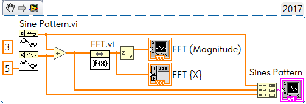
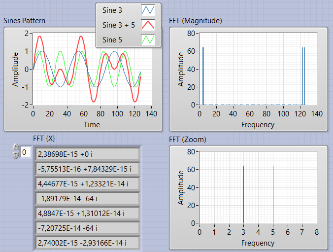
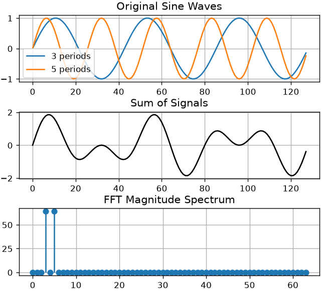

Some trivial exercises with Fourier.

<!--more-->

## 1. Baiscs

Just to refresh knowledge, a very basic example, which almost every student done - take two Sine patterns, add both together and show Fourier spectrum:



And the results,, here two peaks at frequencies 3 and 5, no magic:



Actually you can do exacly the same in Python

```python
import numpy as np
import matplotlib.pyplot as plt

N = 128 # Number of samples
n = np.arange(N) # Sample index

# Generate signals
signal_3 = np.sin(2 * np.pi * 3 * n / N) # 3 periods
signal_5 = np.sin(2 * np.pi * 5 * n / N) # 5 periods
signal_sum = signal_3 + signal_5 # Sum signals

fft_result = np.fft.fft(signal_sum) # FFT
fft_mag = np.abs(fft_result) # Magnitude

# --------- Plots ---------

```

And result will be the same:



Take a note, that the amplitude of the peaks is exactly the same as in LabVIEW - 64, and there is a reason.

I wish i have had such tools thirty five years ago, I have done this on programmable calculator.

## 2.Gauss

If you will take other signal, let try Gauss Monopulse, then you will get other spectrum:

